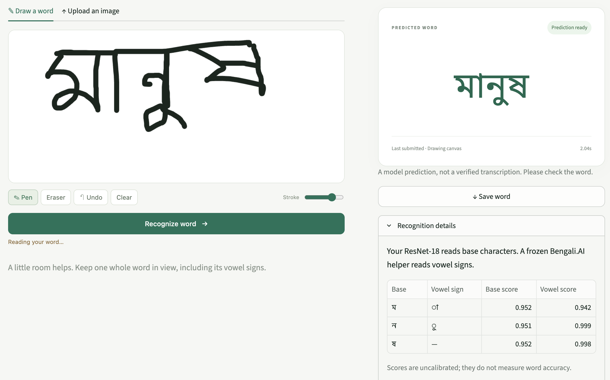
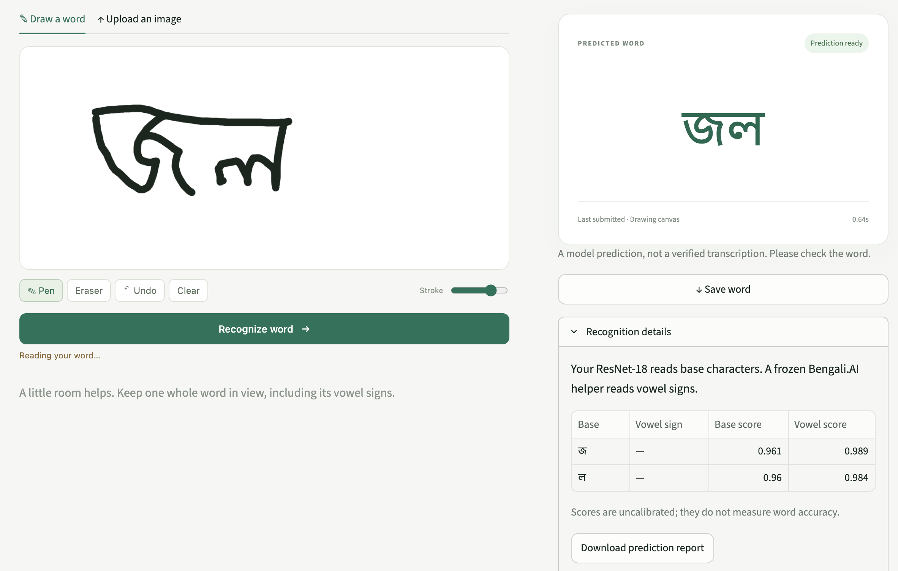
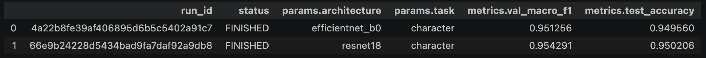

# Lipi — Bangla Handwritten Word Recognition

**Name:** Sakib Rayhan Yeasin

**Student ID:** 1000128462

**Course:** SICIP · Assignment 04 · BRAC University

Draw or upload one handwritten Bangla word. Lipi displays the **complete predicted word**, including vowel signs. The interface supports pen, eraser, undo, clear, and downloading predictions.

## Approach

| Step | What was done | Why |
|---|---|---|
| Dataset inspection | Checked the 84 BanglaLekha-Isolated classes, image quality, duplicates and class counts. | Find bad samples before training. |
| Character training | Fine-tuned ResNet-18 and EfficientNet-B0 on the same cleaned data splits. | Compare two efficient models fairly. |
| Training strategy | Used augmentation, early stopping, saved checkpoints and MLflow. Grouped splits by collection form. | Reduce overfitting, track results and recover interrupted training. |
| First word prototype | Segmented words, classified character crops and joined the characters. | Reuse the trained model without training a separate word model. |
| Final hybrid | Kept my ResNet-18 for base characters and added a frozen Bengali.AI vowel-sign classifier. Compared possible cuts and joined the best character/sign sequence. | Handle vowel signs that the isolated-character model does not separately recognize. |

The external helper comes from [ifrit98/bengaliai](https://github.com/ifrit98/bengaliai). Only its **11-class vowel output** is used. Base characters still come from my trained ResNet-18. Neither model trains when the app runs.

### Character results

| Model | Test accuracy |
|---|---:|
| ResNet-18 — selected | 95.02% |
| EfficientNet-B0 | 94.96% |

These scores measure **isolated characters**, not complete words. ResNet-18 was selected because its character-test accuracy was slightly higher. Both experiments, classification reports, learning curves and timing results are saved in `training_runs/`.

### What failed, and why

- **The first segmentation prototype gave poor word results.** Bangla letters share a headline, and vowel signs may sit beside, above or below a letter. Simple cuts can split one character or merge several. Geometry rules alone did not reliably recover the signs.
- **The hybrid still makes mistakes.** Incorrect cuts, unfamiliar handwriting and unsupported conjuncts can produce the wrong word. The pretrained vowel helper also saw different handwriting data. A high model score does not guarantee a correct word.
- **Automatic 200-word accuracy was unavailable.** The supplied PromitoLipi XML contains numeric component labels without a verified Unicode word mapping. A separate word model was not trained on those files. Section 10 instead shows images beside predictions; numerical accuracy needs independently checked reference words.

## My screenshots

These are my own app captures. They show successful examples, not a measured overall word accuracy.

**মানুষ — drawing and complete-word prediction**



**জল — drawing and complete-word prediction**



**Another drawing with character and vowel-sign details**


**Saved MLflow training-run summary**



## Run locally on macOS

From the project root, use the existing environment:

```bash
source "../../.venv/bin/activate"
uv pip install --python "../../.venv/bin/python" -r requirements.txt
```

The app needs these local model files:

```text
models/
├── resnet18.pt
└── vowel_helper/
    ├── model.h5
    └── class_map.csv
```

They are already available in this workspace. For a fresh setup, restore your saved checkpoint and download the pinned helper once:

```bash
cp training_runs/macos_resnet18_efficientnetb0_v1/character/resnet18/best_model.pt models/resnet18.pt
KERAS_BACKEND=torch python -c "from hybrid_ocr import prepare_vowel_helper; prepare_vowel_helper(download=True)"
```

Start the server:

```bash
python -m streamlit run app.py --server.address=127.0.0.1 --server.port=8501
```

Open **http://127.0.0.1:8501**. Draw a whole word and click **Recognize word**, or upload an image and click **Recognize image**. No labeling input is required. Models load on the first prediction and are reused afterward. Inference works offline once the model files are present.

Weights and datasets are excluded from Git. A fresh clone needs your saved checkpoint. The app also supports the original training-run checkpoint path, or custom paths through `MODEL_PATH` and `VOWEL_HELPER_DIR`.

## Run with Docker

Start Docker Desktop. From the project root:

```bash
docker build -t bangla-ocr-app:0.1 .
docker run --rm --name bangla-ocr-app -p 8501:8501 \
  --mount "type=bind,source=$(pwd)/models,target=/app/models,readonly" \
  bangla-ocr-app:0.1
```

Open **http://localhost:8501**. If the local app already uses this port, stop it or change the mapping to `-p 8502:8501` and open port 8502. Stop the container with `docker stop bangla-ocr-app`.

The image runs CPU inference as a non-root user. Model files are mounted read-only; datasets and training runs are not copied into the image. The Docker build, server health, inference and text download were checked locally.

## Notebooks and experiments

| Notebook | Purpose |
|---|---|
| `01_dataset_eda.ipynb` | Inspect and clean the dataset. |
| `02-model-training.ipynb` | Train both models, log MLflow experiments, compare and save weights. |
| `03_segmentation_prototype.ipynb` | Earlier segmentation baseline. |
| `04_hybrid_word_recognition.ipynb` | Hybrid inference and the 200-image prediction gallery. |

Use the **Python Work (.venv)** kernel and launch notebooks from the project root. Training stays in the notebook. Install its dependencies with:

```bash
uv pip install --python "../../.venv/bin/python" -r requirements-training.txt
python -m jupyterlab
```

Saved checkpoints allow recovery after interruption with compatible data, settings and library versions. Completed experiments can be reused without retraining.

To inspect both MLflow runs:

```bash
uv pip install --python "../../.venv/bin/python" "mlflow==2.22.5"
python -m mlflow ui \
  --backend-store-uri ./training_runs/macos_resnet18_efficientnetb0_v1/mlruns \
  --host 127.0.0.1 --port 5000
```

Open **http://127.0.0.1:5000** and select the character experiment.

For 200 word predictions, run **section 10** of notebook 04 independently. Change `PAGE` to browse, or open `reports/hybrid_word_recognition/test_200_words/images_and_predictions.html`. Interrupted inference resumes from saved predictions.

## Project files

```text
app.py                       Streamlit server
ocr_service.py               Image validation and model paths
hybrid_ocr.py                 ResNet + vowel-sign recognition
segmentation_ocr.py           Character model and segmentation
hybrid_evaluation.py          Evaluation helpers
word_benchmark.py             Resumable word evaluation
run_200_word_test.py          CPU inference workers
01–04 notebooks              EDA, training and recognition experiments
requirements*.txt            App and notebook dependencies
Dockerfile                   Application container
.streamlit/ and ui/          Theme and drawing interface
labels.json                  Original 84 class labels
models/                      Local inference weights; ignored by Git
training_runs/               Checkpoints, reports and MLflow runs; ignored
reports/                     Generated galleries and diagnostics; ignored
screenshots/                 My screenshots shown above
examples/ and tests/         Evaluation lists and software checks
github_link.txt              Repository URL
```

Run image-input checks with `python -m unittest discover -s tests -p test_app.py -v`. The full test suite also needs the local models and dataset: `KERAS_BACKEND=torch python -m unittest discover -s tests -v`.

## Data and references

- [BanglaLekha-Isolated](https://data.mendeley.com/datasets/hf6sf8zrkc/2): character-training dataset.
- PromitoLipi: local handwritten word images used for visual testing.
- [Bengali.AI helper](https://github.com/ifrit98/bengaliai): pinned revision and checksums in `vowel_helper_sources.json`; label references are in `label_sources.json`. Upstream helper assets are downloaded locally, not bundled in Git or the Docker image; no upstream license was present at the pinned revision.
- [Repository](https://github.com/Sakib179/BanglaLekha): keep public and accessible for at least one year, as the assignment requires.
